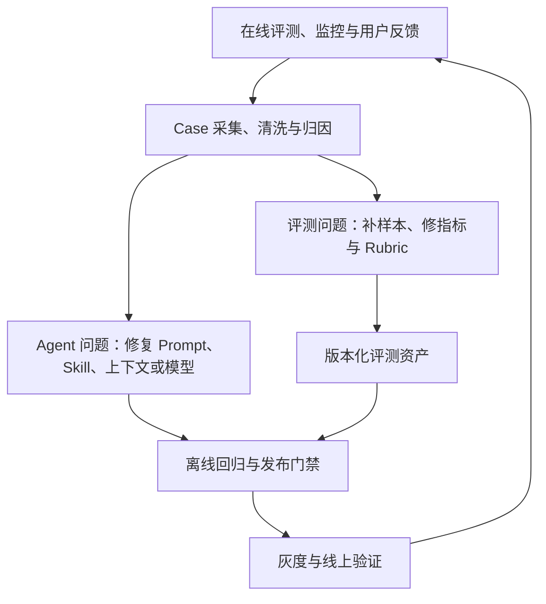

# 评估、反馈与可观测性

Agent 评测要回答：**当前版本好不好、哪里出了问题、改完是否真的变好。** 观测提供证据，评测给出判断，归因指明修改方向，再通过回归和线上验证确认效果。

本文整合原有实践笔记与图灵 Agent 评测团队的两篇文章，按建设流程重新组织。来源见文末；落地模板、示例和自查项是综合整理，不是原文规范。

## 一、评测全景：四个模块、两条迭代闭环

### 1. 评测对象是整个任务系统

Agent 的效果取决于模型、Prompt、Skill、工具、知识库、记忆、上下文管理和业务流程的共同作用。评测对象是它们组成的系统；其中任何环节变化，都可能造成能力变化。

两个 Agent 即使都完成了任务，也可能一个稳定高效，另一个反复试错后偶然成功。评测应覆盖四层：

| 层次 | 核心问题 | 关注内容 |
|---|---|---|
| 结果 | 事情完成了吗？ | 任务成功、输出可用、最终环境状态 |
| 过程 | 怎么完成的？ | 规划合理性、工具选择、约束保留、步骤稳定性 |
| 效率 | 代价是否可接受？ | 耗时、Token、工具调用次数、单任务成本 |
| 风险 | 是否产生不该发生的影响？ | 越权、误操作、约束违反、安全隐患 |

**Response Evaluation 看输出，Trajectory Evaluation 看执行轨迹，Outcome 检查看环境中的真实结果。** 例如，Agent 回复“航班已预订”只是一条输出，预订系统中实际存在符合要求的订单，才是任务完成的证据。

### 2. 四个模块的职责

| 模块 | 回答的问题 | 主要产出 |
|---|---|---|
| 离线评测 | 本次变更是否破坏已有能力？ | 固定条件下的版本对比、回归报告、发布门禁结论 |
| 在线评测与监控 | 真实用户是否受益？线上是否稳定？ | A/B 结果、巡检结果、异常信号、流量变化 |
| Case 挖掘与归因 | 哪些样本值得分析？根因是什么？ | Good/Bad Case、修复任务、评测标准修订 |
| 观测基建 | 能否还原当时发生了什么？ | Trace、上下文、工具记录、状态与版本信息 |

这套模块划分来自《评测全览》，用于厘清职责，并非行业唯一分类。关键是具备**发现问题、定位问题、驱动演进**三种能力，并沉淀可复用的评测资产。

### 3. 同时迭代 Agent 与评测体系



- **Agent 迭代闭环**：定位系统问题 → 修复 → 回归 → 上线验证。
- **评测体系迭代闭环**：发现样本覆盖不足或标准误判 → 补充样本、修订 Rubric → 校准评测结果。

两条闭环共享 Case 与评测资产。不能默认“评测判失败就一定是 Agent 错了”：如果标准偏离用户需求，持续优化只会让 Agent 更擅长迎合错误标准。

## 二、指标与标准：从业务目标到 Rubric

### 1. 先定义用户目标，再选择指标

不要从“能采集什么数据”出发，而要先问：用户为什么来？达成目标时会做什么？遇到问题时会做什么？

模型能力与业务结果之间，需要任务层指标连接：

**模型能力 → Agent 任务表现 → 业务系统表现 → 业务价值。**

以 AI 搜索为例，Agent 层看意图理解、检索有效性和结果整合可信度；搜索系统看召回、点击；业务看留存等。由熟悉业务的人共同梳理这些关系，才能解释为什么模型分数提升却没有带来业务收益。

同时把指标分成三组：

| 类型 | 用途 | 电商推荐示例 |
|---|---|---|
| 目标指标 | 衡量最终业务目标 | 下单转化率 |
| 过程指标 | 判断用户是否向目标前进 | 点击率、收藏率、加购率 |
| 护栏指标 | 防止优化产生副作用 | 退货率、退款率、用户纠正率 |

转化率提高但退货率同步恶化，不足以说明推荐质量提高。判断优化效果，需要同时查看目标指标和护栏指标。

指标必须结合场景解释：

- 客服：在解决问题的前提下，减少不必要的对话轮数；轮数短也可能是用户放弃。
- 社交：继续回复、会话时长和再次发起对话可能更有意义。
- 教育：关注后续相似题正确率、提示次数、独立完成率，不能只看即时满意度。

### 2. 组合使用不同评测方法

测试集是承载样本和标准的资产；规则、模型、人工是执行判断的方式；A/B 与用户反馈用于验证线上效果。这些方法可以组合使用。

| 方法 | 适用内容 | 主要限制 |
|---|---|---|
| 规则或程序检查 | 格式、数值约束、数据库状态、明确断言 | 难覆盖开放性语义质量 |
| LLM as Judge | 正确性、完整性、证据支持、复杂语义判断 | 有成本和判断偏差，需要人工校准 |
| 专家评审 | 垂直领域知识、业务规则、复杂争议 | 昂贵、较慢，通常抽样执行 |
| Pairwise 对比 | 比较 A/B 两个结果哪个更好 | 可由人工或模型执行，仍需统一标准 |
| 用户显式反馈 | 点赞、点踩、评分、文字反馈 | 反馈率低，样本存在选择偏差 |
| 用户隐式反馈 | 重新生成、反复改问法、是否采纳、是否完成任务 | 行为含义需要结合上下文解释 |
| A/B Test | 真实流量中的任务成功、转化、留存等 | 需要合理分流、足够流量和护栏 |

**明确可验证的内容优先用规则，开放性问题用模型辅助，专家负责定义和校准标准，线上实验验证业务价值。**

### 3. 用 Rubric 降低主观判断的歧义

“回答是否专业”“方案是否自然”直接打 0～10 分，容易出现评测员理解不同、评分尺度不同的问题。可以将指标下钻为具体检查项，即 Rubric：

1. 把宽泛要求拆成可观察的事实。
2. 尽量使用“通过 / 不通过 / 未知”或 `1 / 0 / unknown`。
3. 明确所需证据、判定边界与例外。
4. 分析 `unknown` 样本，判断是规则不清还是证据不足，再修订标准或补采数据。

以下是商品推荐示例（整理补充）：

| 指标 | Rubric | 判断证据 |
|---|---|---|
| 需求理解 | 是否正确提取预算上限 8000 元？ | 用户输入、约束提取结果 |
| 约束满足 | 推荐商品是否全部不超过预算？ | 推荐清单、商品价格 |
| 事实可信 | 关键参数是否有检索或工具结果支持？ | 最终回答、证据记录 |

统一让“通过”表示满足要求，避免有的检查项“是”代表成功、有的代表失败。证据不足时标记 `unknown`，并明确它是否阻断发布，不能默认当作通过。单项二元化也不意味着整个任务只能得到一个简单的 0 或 1。

### 4. 人人一致，再做人机一致

- **人人一致**：产品、运营、研发、QA 和专家使用同一套标准，先背靠背独立标注，再讨论分歧。
- **人机一致**：用人工判断校准机器评测，验证其能复现这套标准后再扩大规模。

团队需要明确的标准负责人处理分歧，但负责人也要根据真实 Good/Bad Case 和用户变化修正标准。机器预标注只能辅助人工；未验证一致性时，不应直接视为可信的自动化评测。

《评测漫谈》以 85%、90% 举例说明一致性阈值，并报告了部分业务从 62% 提升至 92%、另一业务达到 99% 的人机一致率。这些是原文业务案例，并非通用验收门槛。

行业专家还可以补足公开语料缺失的业务知识。专家存在分歧时，先抽取共识要求；对多种合理策略，建立不同风格或场景的测试集，不要强行把成功路径限制为一种。

## 三、评测资产：样本、标准与覆盖范围

### 1. 一个 Task 应包含什么

广义评测集由问题、参考答案或预期行为、评价标准组成。长程任务可用 `(prompt, expected_behavior, trace)` 描述一次评测，但要注意：**输入和预期属于任务定义，Trace 是执行后产生的记录。**

| 概念 | 含义 |
|---|---|
| Task | 输入和成功标准明确的单个测试任务 |
| Trial | 对该任务的一次执行尝试 |
| Rubric | 最小粒度的判断标准 |
| Grader | 执行评分或检查的逻辑，可包含多个检查项 |
| Trace / Trajectory | 一次执行的输入输出、工具调用、中间结果和状态变化记录 |
| Outcome | 执行结束时环境中的实际状态 |
| Evaluation Suite | 面向某类能力或行为的一组任务 |
| Agent Harness | 编排模型、工具、状态与执行的运行系统 |
| Evaluation Harness | 运行任务、采集记录、执行评分并汇总结果的评测系统 |

一个实用的任务模板如下（整理补充）：

```yaml
id: recommendation_budget_001
scenario: 商品推荐
prompt: 推荐一台不超过 8000 元的笔记本，不要苹果品牌
fixture: catalog_snapshot_v1
expected_behavior:
  - 推荐符合预算与品牌约束的商品
  - 商品参数有数据来源
rubrics:
  - id: budget_constraint
    criterion: 所有推荐商品价格均不超过 8000 元
    evidence: 推荐清单和商品数据
    required: true
  - id: brand_constraint
    criterion: 所有推荐商品均非苹果品牌
    evidence: 推荐清单和商品数据
    required: true
```

实际还需记录评测集、Rubric、Judge 和 Agent 的版本，以及运行环境、试验次数等信息，确保比较结果可解释。

### 2. 端到端与过程评测互补

| 维度 | 端到端评测 | 过程评测 |
|---|---|---|
| 视角 | 用户任务是否完成 | 中间环节是否正确 |
| 示例 | 是否交付数据准确、可使用的经营分析 PPT | 取数、合并、分析、生成文件是否正确 |
| 作用 | 判断是否出现整体退化 | 缩小问题范围、对应模块负责人 |
| 局限 | 单独使用时难定位根因 | 局部达标不保证用户任务完成 |

端到端评测按用户功能组织，例如“门店经营分析”和“门店百科问答”各有自己的任务集，即使它们共用部分 Skill。过程评测再按真实问题细化为 Skill、检索、知识库、数据处理等子集。

先覆盖核心端到端任务与关键过程；当出现“知道效果变差但找不到原因”时，再细分过程评测。若端到端下降、已有过程指标却正常，也可能是过程覆盖不足或环节间交互出了问题，不能据此认定系统正常。

### 3. 按用途维护不同集合

| 集合 | 主要用途 |
|---|---|
| 黄金集 | 展示团队认可的高质量完成范式，校准“什么算好” |
| 错题集 | 沉淀历史失败及修复后的预期，防止同类问题复发 |
| 必过集 | 覆盖核心功能和关键约束，作为发布底线 |
| 挑战集 | 探索困难任务、长尾场景和能力边界 |

这是与“端到端 / 过程”正交的分类：二者都可以有必过集和挑战集，同一案例也可能同时属于错题集与必过集。挑战集需要随真实需求更新，避免长期测量已经脱离业务的问题。

### 4. 冷启动与持续扩充

样本来源可以从人工编写开始，由 AI 辅助扩写，再逐步引入线上真实案例。Good Case 定义质量范式，Bad Case 暴露能力边界，两者都需要。

冷启动通常先构建少量核心样本，确认基线能力。是否可以直接小流量上线采集案例，应权衡业务容错率、种子集构建成本和线上试错代价。起步重点是形成闭环，而不是一次建立庞大指标库。

## 四、离线回测：控制变量与发布门禁

### 1. 固定一次比较的条件

离线回测用于检查模型、Prompt、知识库、工具或 Skill 变更后的效果。版本对比时应固定样本、评测标准、评分器和尽可能接近生产的执行环境，只改变待验证的因素。

环境保真度包括工具接口行为、数据快照、用户历史文件、必要权限与初始状态。测试环境缺少上下文或数据与线上不同，都会使评测结论偏离生产表现。

评测资产需要长期演进，但**同一次版本比较必须使用同一版资产**。可将同批样本的离线与线上影子执行结果对照，检查环境差异；不能把环境导致的差异直接归因于模型或 Prompt。

### 2. 多次试验与成功率口径

同一 Task 多次执行可能得到不同结果，应通过多次 Trial 观察成功率与波动，并同时记录耗时和成本。

这里需要区分三个概念：

| 指标 | 含义 | 关注的问题 |
|---|---|---|
| 普通通过率 | 成功试验数 / 总试验数 | 一次执行通常有多可靠？ |
| `pass@k` | k 次尝试中至少成功一次的概率 | 允许多次尝试时，能否找到成功解？ |
| `pass^k` | k 次尝试全部成功的概率 | 多次执行能否持续保持成功？ |

《评测全览》将多次 Trial 与 Pass@k 放在一起描述；笔记在此按 [Anthropic 的定义](https://www.anthropic.com/engineering/demystifying-evals-for-ai-agents)区分口径。**“多跑几次再计算通过率”不等于 `pass@k`。** 高 `pass@k` 也不能直接证明单次交付稳定。

### 3. 分层设置发布门禁

- 安全、权限和关键数据准确性检查：按业务要求设为硬门禁，失败阻断发布。
- 核心任务：检查必过集和关键指标是否退化。
- 体验和效率：设置适用阈值，比较质量收益与成本变化。
- 挑战任务：观察能力边界是否拓展，但不应默认每次发布都必须提高总分。

门禁应接入 CI/CD 或正式发布流程，明确执行条件、判定标准和责任人。只有报告而没有发布约束，无法稳定阻止退化。

离线结果受样本覆盖和环境真实性限制：它守住的是已有覆盖范围内的能力。离线总分提高并不能代替线上业务验证，未覆盖的新需求仍要靠在线机制发现。

## 五、在线评测、巡检与监控

### 1. 三种在线质量观察方式

| 方式 | 做法 | 主要价值 |
|---|---|---|
| 影子模式 | 将真实请求复制给候选版本，结果不直接影响用户 | 用真实输入检查上线前的表现与环境差异 |
| A/B Test | 对真实流量进行版本分组 | 验证任务效果及业务价值 |
| 巡检 | 周期执行代表性 Task，持续记录质量变化 | 发现核心能力是否退化 |

影子执行若涉及写操作，需要隔离副作用，避免重复下单、发消息等。巡检可以从离线集中挑选代表性任务，也可以独立维护；它既做质量判断，也产生供 Case 挖掘使用的异常信号。

### 2. 区分质量与运行状态

**HTTP 200、工具调用成功，不代表任务正确完成。** 工具每次都正常返回，但数据错误时，运行监控可能正常，质量评测仍然失败。

按需要挑选核心指标，不必一开始全部监控：

| 类别 | 常见指标 |
|---|---|
| 结果与质量 | 任务成功率、用户纠正率、约束违反率、无依据结论率、证据覆盖率 |
| 理解与检索 | 意图识别、槽位提取、工具选择准确率、检索命中率与空结果率 |
| 可用性 | Skill/Tool 成功率、失败率、超时率、异常类型、LLM 调用错误率 |
| 成本与效率 | 端到端耗时、节点耗时、Token 消耗、单任务成本、平均步数 |
| 计划与恢复 | ReAct 循环次数、最大循环命中率、Retry/Replan 比例及恢复成功率、回滚率 |
| 上下文与状态 | 关键约束遗漏率、Context Token 使用量、Checkpoint 失败率 |
| 兜底 | 降级率、人工介入率、任务中断率 |
| 流量与行为 | 任务类型分布、Skill 调用频次、对话轮数、重新生成比例 |

指标变化要结合任务构成分析：成功率下降并伴随工具失败率上升，优先排查工程问题；工具正常但新任务占比上升，可能是需求分布变化和场景覆盖不足。这些是归因线索，还需要样本证据验证。

## 六、Case 挖掘、归因与反馈回流

### 1. 同时采集异常样本与随机样本

将来源归纳为四类：

| 来源 | 示例 | 盲区 |
|---|---|---|
| 用户反馈 | 点踩、投诉、重新生成、反复纠正 | 用户未表达的不满不可见 |
| 评测与监控信号 | Judge 低分、巡检失败、工具异常、指标波动 | 受已有指标覆盖范围限制 |
| 规则挖掘 | 多次 Replan、连续失败、超预算、反复改问法 | 只能主动寻找已想到的风险 |
| 真实流量抽样 | 随机抽取任务，查看完整执行记录 | 成本较高，但有助于发现未预设的问题 |

不能只收负反馈和异常：随机样本有助于发现既有规则没覆盖的情况，Good Case 则用于明确质量范式。

### 2. 从原始会话到可回归资产

**采集 → 清洗 → 评测 → 质检 → 分析归因 → 修复或修订标准 → 回归与线上验证。**

清洗包括去重、分类、补上下文和修复脏数据；质检包括检查标注一致性、规则稳定性及判断证据。一个可用 Case 应保留任务输入、必要上下文、工具结果、最终输出、真实状态、用户反馈和版本信息，不能只保存一句失败回答。

### 3. 归因要同时检查系统与评测标准

可按以下层次排查（综合整理）：

| 层次 | 典型问题 | 可能动作 |
|---|---|---|
| 输入理解与规划 | 漏掉需求、任务拆解不合理 | 改约束提取或规划策略 |
| Prompt / Skill 路由 | 指令模糊、描述重叠、调用错误 Skill | 改指令、描述与路由规则 |
| 上下文与记忆 | 压缩丢失约束、历史信息未加载 | 修复上下文管理 |
| 工具与环境 | 参数错误、数据错误、权限或依赖缺失 | 修接口、数据、权限或环境 |
| 模型能力 | 在条件充分时仍不能完成任务 | 调整任务设计或验证模型替换 |
| 评测本身 | Rubric 误判、样本缺上下文、遗漏场景 | 修标准、补证据和评测样本 |

同一个 Case 可能同时触发两条闭环。例如用户说“不要苹果”，Agent 仍推荐 iPhone：检查发现约束在上下文压缩中丢失，需要修复 Context 管理；同时把案例加入错题集，并补齐品牌约束检查。

### 4. 自动演进的边界

Evaluation / Optimization Agent 可以辅助读取指标、抽取异常样本、聚类、归因并生成修改建议，但候选 Prompt 或 Skill 仍应经过回归和线上验证。

自动化优化需保留护栏指标，并为系统提示词、权限、安全策略和资金操作等高风险变更设置人工审查。原有能力不退化和风险可控，应成为优化流程的显式条件。

## 七、可观测性：让失败能够被还原

### 1. 从调用链扩展到执行决策链

Metrics 描述整体状态，Trace 串联一次任务的执行，Log 提供节点细节。Agent 还需要看到每个关键步骤实际得到的输入、选择的动作和产生的结果。

| 记录类别 | 关键内容 |
|---|---|
| 输入与理解 | 用户输入、意图、槽位、硬约束 |
| 上下文 | 实际注入的 Prompt、检索内容、记忆及压缩结果 |
| 计划与动作 | 当前计划、执行步骤、路由结果、可记录的决策摘要 |
| 工具与证据 | 工具名称、参数、返回、异常、Observation |
| 状态变化 | Retry、Replan、Rollback、Checkpoint、环境修改 |
| 结果与版本 | 最终输出、真实产物、任务状态、模型与配置版本 |

不应把记录决策链理解为必须获取模型不可见的内部思维过程；工程归因主要依赖可记录的输入、动作、结果和状态证据。

完整 Prompt、Context 和工具结果不宜无限期全量保存，应按排查需求、数据敏感性设计脱敏、抽样和保留期限。

### 2. Context 是关键排查对象

用户预算为 8000 元，却推荐了 9999 元商品，可以逐环检查：

**原始输入 → 预算提取 → Context 保留 → 工具参数 → 工具返回 → 最终推荐。**

这能区分是理解错误、压缩丢失约束、参数传错，还是最终生成阶段没有遵守证据，避免把所有问题都归结为“模型不够聪明”。

### 3. 用 Checkpoint 缩小范围

Checkpoint 应保存任务状态、关键上下文、中间产物、约束检查与证据，而不仅是 `step_success=true`。

排查时先找到仍正确的状态与已经出错的状态，检查两者之间的步骤；优先查看上下文压缩、路径切换、外部工具调用、Replan 和关键状态修改等节点，再反向追踪因果。

在线性且错误边界较清晰的链路中，可以借助中间节点缩小范围；但重试、恢复和多分支执行会破坏这种条件，不能机械地把所有 Trace 当作可二分的单调序列。

冷启动先做到**最小可归因**：保留模型调用输入输出和 Skill/Tool 记录，能还原典型 Bad Case。需要自动判断某件事却缺少证据时，再补埋点和观测能力。

## 八、长程 Agent 与 Skill 的落地要求

长程 Agent 需要多步拆解、反复调用工具、读取中间产物、动态调整策略。因此评测既要检查最终产物，也要检查关键行为与状态约束；合理的替代路径应被允许。

随着 Skill 创建者和数量增加，人工逐条阅读长轨迹难以扩展。人工重点承担标准设计、分歧处理和高价值复核，AI 承担规模化初筛与回归，平台提供记录、回放和管理能力。机评规模化仍以人机一致为前提。

| 平台能力 | 落地作用 |
|---|---|
| 全链路回放 | 还原任务的执行与状态变化 |
| Case 管理 | 统一维护样本、上下文、约束、Rubric 与版本 |
| 执行沙箱 | 隔离只读、可写及高风险任务的运行影响 |
| AI 评测引擎 | 执行 Rubric，支持校准、判分和证据追溯 |
| 报告与归因 | 解释失败发生在规划、工具、环境或 Skill 的哪个环节 |
| 自动回归 | 模型、Prompt、Skill 等变化后验证历史任务 |
| 发布门禁 | 将结果接入开发、发布和运营流程 |

## 九、建设顺序与成熟度自查

### 1. 按阶段补齐能力

| 阶段 | 优先建设 | 阶段产出 |
|---|---|---|
| 冷启动 | 最小可归因、核心任务集、少量 Rubric、基本回归 | 能判断基线、解释典型失败、守住核心功能 |
| 灰度扩量 | 标准对齐、在线评测、流量抽样、Case 归因与回流 | 能发现新需求和未知问题，持续修订评测资产 |
| 稳定运营 | 自动回归、持续巡检、分层门禁、规模化机评 | 质量、成本和风险可持续跟踪，变更有证据 |
| 自动演进探索 | 自动聚类与建议、候选变更验证、风险审查 | 在明确约束下提高优化效率 |

常见缺口是只有离线集而看不到线上变化，只有监控而无法验证改动，或两者都有却缺少 Case 回流。最后一种看似完整，但线上问题无法变成下一次发布的检查项。

### 2. 实用自查清单

以下为综合整理，不对应原文逐项的 L0～L3 评级：

- 能否为核心功能明确任务成功标准，并检查真实产物或状态？
- 是否同时覆盖端到端任务和关键过程？
- 人工与机器评测是否校准，`unknown` 和争议样本是否有人处理？
- 版本比较是否固定样本、标准和环境，并记录重复试验的波动？
- 回测是否真正接入发布流程，关键失败是否能够阻断发布？
- 是否通过线上质量评测、监控及随机抽样发现新问题？
- Bad Case 是否能通过 Trace 归因，并回流为回归样本？
- 是否定期检查评测标准本身的偏差与样本分布变化？
- 能否用业务目标、过程指标和护栏共同解释一次优化的收益？

面试或项目复盘时，可沿着“业务目标 → 评测标准 → 数据集 → 回归门禁 → 在线验证 → Case 归因”讲清闭环，提供真实的样本规模、任务成功率、用户纠正率、工具成功率、成本及优化前后变化。没有测量的数据，不应编造成优化效果。

## 参考资料

1. 公众号-美团技术团队：[《Agent评测漫谈 —— 由浅入深讲解Agent评测》](https://mp.weixin.qq.com/s/gZKWRqznB8sNBFf69fBIvw)：评测方法论、标准对齐、Rubric 与长程任务评测。
2. 公众号-美团技术团队：[《Agent 评测白皮书》系列01：Agent 评测全览](https://mp.weixin.qq.com/s/hBSIPQnsBeWwX9UZLjWYFA)：四个模块、两条迭代闭环、评测资产、离线门禁与线上反馈。
3. Anthropic：[Demystifying evals for AI agents](https://www.anthropic.com/engineering/demystifying-evals-for-ai-agents)：用于核对 `pass@k` 与 `pass^k` 的定义。
4. 极客时间：[AI Agent系统设计面试现场](https://time.geekbang.org/column/article/1008245)：你怎么知道用户喜不喜欢你的 Agent？
